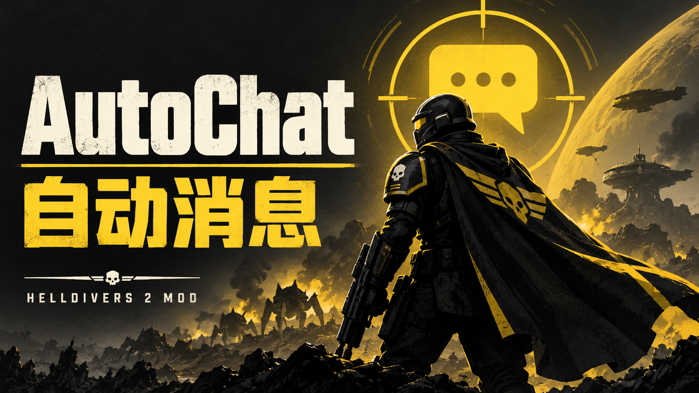

# AutoChat

English / [简体中文](https://github.com/Puipipi/HD2-AutoChat/blob/main/README_cn.md)



[Cover artwork notes](assets/cover-autochat.prompt.txt).

A Helldivers 2 mod for the Bingus/MDL loader: **send text to the squad without opening the chat box.** The current release is [AutoChat 1.1.3](https://github.com/Puipipi/HD2-AutoChat/releases/tag/v1.1.3), build `v1.1.3-build.1`.

| Item | Value |
| --- | --- |
| Game resource | `mods/codex/auto_chat` |
| GUID | `a1000000-0000-4000-8000-000000000022` |
| Dependency | Bingus Shared Loader v15+ / API 1 |
| Recorded target | Steam build 25480438 / EXE 1.8.46015.0 |
| Panel toggle | K without a working Mod Bindings Menu registration; otherwise bind the AutoChat action in **Mods → AutoChat** |

## Panel and scheduled messages

Open the panel, then choose **Settings → Alerts → Stratagem rules** or **Enemy size / flying alerts**. Host and client profiles store their rules separately. Stratagem rules provide per-entry switches, separate world-marker and call-in messages/cooldowns, search by name or ID, paging, color filters, and batch changes for a group or filtered results. Mission stratagems have a separate group switch; red, blue, and green controls only affect their own color groups. The current catalog has 149 valid native entries organized into 135 settings groups; new game data may change this. The six confirmed SEAF shell mission buildings use the existing mission-building alert path. See [stratagem reference](docs/STRATAGEM-REFERENCE-0.8.0.md), [enemy coverage](docs/ENEMY-COVERAGE-0.8.0.md), and [ping classification](docs/PING-CLASSIFICATION-0.7.0.md).

Enemy alerts support small, medium, large, massive, and flying categories. Flying classification takes priority over size; ordinary supplies are excluded. The size labels come from the game's `UnitSize` enum, not armor or threat level. Coverage is tied to a dated game-data snapshot, not a guarantee for future enemies. A game binary change disables unsafe reads until offsets are checked again.

Leave a per-rule message blank to use the selected preset's default. A blank cooldown uses the global per-player interval; a numeric value is tracked per triggering player and rule. `0` allows every new valid event through the cooldown check while the master switch, session checks, and event deduplication still apply. Default profiles do not add zero-cooldown rules. Template hints follow the interface language, and Chinese and English aliases can be mixed. Examples and variable meanings are in [player templates](docs/PLAYER-TEMPLATES.md).

Scheduled tasks support repeating intervals, one-time countdowns, and local-time daily schedules. Intervals and countdowns accept 5 seconds through 24 hours; daily schedules use times such as `21:30`. Messages allow up to 200 UTF-8 bytes. Tasks use system time rather than frame count. A missed repeating schedule sends once, countdowns include time while the game is closed and are attempted on the next run, and daily tasks are attempted at most once per day. They wait when session, chat, or role conditions disallow output, and the panel shows the reason. Tasks do not consume event cooldowns; the earliest due task runs first. Data is saved to `%LOCALAPPDATA%\CowboyBingus\Helldivers2\AutoChat\tasks.txt` and is never executed as Lua.

The panel has a settings tab with sections for scheduled tasks, automatic messages, and alerts. Choose which host/client profile to edit in the upper-right; the current game role selects which profile is active. Drag the title bar to move the panel; the position scales with resolution and is saved. Use Ctrl plus/minus to scale and Ctrl+0 to reset. Lists and details scroll within their own regions; click a task row to view its full name and message. Click and release on the same control to activate it; moving away before release cancels the action.

When open, AutoChat blocks game keyboard and mouse input and releases the mouse for panel interaction. It restores input on close, focus loss, or exit. During text editing K is treated as a character; leave the field to use the hotkey. The close button remains available. Ctrl+V pastes Unicode, Enter confirms, Esc cancels, and Ctrl+A selects all. Editing a task draft does not alter an already-added task until saved. See the [stratagem rules preview](docs/stratagem-rules-preview.png), [enemy rules preview](docs/enemy-rules-preview.png), and [settings preview](docs/settings-preview.png); these are mockups, not game screenshots.

With Mod Bindings Menu available and AutoChat's action successfully registered, the menu action becomes the only toggle source. It starts unbound, so assign a key on **Mods → AutoChat**. The old K key no longer toggles after registration. If the menu is absent, not ready, or registration fails, K remains the fallback. Offline tests use simulated native action-state bytes; they cannot confirm that the game keeps updating the action while AutoChat's input lock is active. Verify that the selected key opens and closes the panel in game.

Plugins retain the API v2 handshake and can negotiate revisions and capabilities for independent sends, role settings snapshots, constrained drawing, and optional preset hooks. See [Plugin API](docs/PLUGIN-API.md). Plugin sends are not automatically recolored.

### Default messages and language

New profiles use fixed English message templates. Built-in Chinese and English presets exist for both host and client (`builtin-host-zh`, `builtin-host-en`, `builtin-client-zh`, `builtin-client-en`) and cannot be overwritten, renamed, or deleted. Select a preset and choose **Apply** to replace the selected role's settings; changing the game interface language does not apply a preset or rewrite saved messages. English UI hides built-in Chinese presets without deleting their IDs or data. Old configurations without `message_language` are read as `auto` while retaining their original text. New configuration defaults to English messages; applying a Chinese built-in preset selects fixed Chinese messages. `message_language` belongs to each preset; there is no separate message-language setting in the main settings page.

The player name and abbreviated prefix in automatic messages share the teammate-color setting. Plugin text is not automatically colored. Local-only chat output uses the game's ordinary chat row and name format; it is not a nameless system broadcast.

### Named presets and file exchange

Host and client have independent named-preset libraries and remember the selected item per role. A preset stores automatic-message options, scheduled-task definitions, and per-stratagem/per-enemy rules. User presets can be saved, replaced, renamed, applied, deleted, exported, and imported as `.autochat` files. Import only adds an item to the local library. Applying it updates the selected role and does not switch host/client identity. Applying task definitions creates new task IDs and deadlines. Older presets without task definitions leave that role's current tasks intact.

The `.autochat` format bounds and validates fields, escaping, and UTF-8 text, and does not execute Lua. Optional plugin data in profile v5 is escaped opaque bytes and need not be UTF-8. Writes use a temporary file and atomic replacement. A preset is limited to 1 MiB, the library to 16 MiB, and tasks to 16 MiB. If a library file is damaged, the panel reports the error and disables library operations instead of overwriting it with an empty library. See [automation verification 0.8.0](docs/AUTOMATION-0.8.0-VERIFICATION.md), [0.7.9](docs/AUTOMATION-0.7.9-VERIFICATION.md), and [0.7.8](docs/AUTOMATION-0.7.8-VERIFICATION.md).

Legacy enabled single-task timers migrate once from `panel.txt` to the task list. Unsaved task definitions cannot be recovered. Older task migration and role behavior are detailed in the verification notes above.

## Why no chat box is needed

The game chat box captures input, draws a window, collects keys, and finally calls a send function. AutoChat uses that final send path without opening the window. The recorded call uses the network context's chat object at `ctx + 0xC418` and `game.dll + 0x1097560`. This is based on a read-only reference implementation and the project's recorded checks; the project does not redistribute that reference source. The [multiplayer delivery report](docs/LIVE-EVIDENCE-MULTIPLAYER-2026-10-08.md) describes the dated live test and its limits.

```text
ctx + 0xC418                      chat object in the network context
game.dll + 0x1097560              LmChatSend(chat, 0, text_buffer)
```

## Safety design: verify before calling

Absolute addresses are observations for a particular game binary and can become invalid after an update. At startup, the mod checks five machine-code prefixes; any mismatch disables sending for that session and reports the expected and actual bytes. It casts a callable function pointer only after validation. Before each send it checks the network session, chat object, and game text-chat setting. Lua `pcall` catches Lua errors only; it cannot catch a native process fault. Prefix lengths stop before relative-call bytes whose relocation can change without changing function identity. Offline provenance tests compare bytes with the recorded reference.

| RVA | Meaning | Checked bytes |
| --- | --- | ---: |
| `0x1097560` | chat send function | 32 |
| `0x0bde430` | RPC send | 28 |
| `0x186025d` | chat-box call site | 21 |
| `0x0beb103` | chat message RPC construction | 16 |
| `0x1097a7c` | chat-history read | 12 |

### Cross-mod `ffi.cdef` conflicts

LuaJIT's C namespace is process-wide, and the first `ffi.cdef` declaration is retained. Function prototypes must match other mods' declarations. The shared `VirtualQuery` prototype returns `size_t`; success is checked against `MBI_SIZE` (48), not zero. Reads outside `M.REGION_PROBE` first check page state (committed and not guarded).

```lua
size_t VirtualQuery(const void *address, void *info, size_t length);
```

## How to use

1. Import the package through your mod manager, enable **AutoChat** and **Bingus Shared Loader**, then deploy it.
2. Enter a session. The legacy manual squad-send command requires at least one other player; scheduled output can separately be configured for solo sessions.
3. To exercise the repository's local trigger helper, write a line to the trigger file or use its documented commands:

```powershell
python -B tools/send.py 1433223        # send this text as one chat message
python -B tools/send.py inspect        # dump readable text from the chat object; do not send
python -B tools/send.py find 1433223   # search the chat object for these bytes
python -B tools/send.py --status       # read status and recent logs
python -B tools/send.py ring           # print chat history entries
python -B tools/send.py "find 1433223"  # search the chat object byte by byte
python -B tools/send_and_verify.py 1433223   # compare game history before and after
python -B tools/watch_for_squad.py     # wait for another player, then send normally

# Disassemble a memory dump to verify the chat-box call site
# python -B work/standalone/tools/verify_send_site.py --dump <section0.bin> --headers <headers.bin>
```

The trigger file is `%LOCALAPPDATA%\CowboyBingus\Helldivers2\AutoChat\trigger.txt`. Its first non-empty line is sent once, then cleared. `inspect` reads the chat object without sending. Logs are written to `%LOCALAPPDATA%\CowboyBingus\Helldivers2\Logs\AutoChat.log`; status is in `%LOCALAPPDATA%\CowboyBingus\Helldivers2\AutoChat\AutoChat-STATUS.txt`.

```text
%LOCALAPPDATA%\CowboyBingus\Helldivers2\AutoChat\trigger.txt
```

**Manual squad send requires another player in the session.** The settings-based scheduled-task path has a separate “send in solo session” control.

```text
%LOCALAPPDATA%\CowboyBingus\Helldivers2\Logs\AutoChat.log
%LOCALAPPDATA%\CowboyBingus\Helldivers2\AutoChat\AutoChat-STATUS.txt
```

### Reasons sending is refused

| Log message | Meaning |
| --- | --- |
| `nobody else in the session` | The squad has no other player; this is the common manual-send guard. |
| `text chat is off` | The game's text-chat setting is disabled. |
| `no network session` | The game has not entered a session. |
| `signature not verified` | A signature check failed, so sending is disabled. |

## Verified and not verified

A dated live test recorded another player seeing messages in both host and client roles on Steam build 25480438. The project's log also recorded matching signatures and increasing game chat history. This does not validate the current 1.1.3 build, every squad size, all game versions, or all action/input behavior.

Not established by that evidence: delivery to three or four other players, the meaning of the `-1` broadcast argument, client-to-host behavior, keyboard behavior at send time, the exact chat-enabled bit semantics, or the second send-function argument's meaning. The historical ring reader was documented as incorrect, and the text scan did not cover the entire history ring. See the [live evidence report](docs/LIVE-EVIDENCE-MULTIPLAYER-2026-10-08.md) for details.

## Build and tests

From the repository root, validate source and run offline tests:

```powershell
# Gate: LuaJIT compile / shared prototypes / calls ⊆ declarations / no memory-write primitive / live detection / README block
python -B work/standalone/build_mod.py --validate-only

# All offline tests, including native-input filter simulation, scheduling, and event policy
python -B -m unittest discover -s work/standalone/tests -p "test_*.py" -v

# Build -> dist/AutoChat-<version>.zip
python -B work/standalone/build_mod.py
```

By default, the package builder writes to the repository root `dist/`; `--output-dir` overrides that location. No deployment or live-game test was performed for this release preparation.

### Build gates that once could never fail

The build gates were moved to `work/standalone/gates.py` so each can be tested with violating input. Earlier checks could pass without finding any declarations or calls: the user32 gate recognized only direct `ffi.cdef[[...]]` blocks, while the source used `pcall(ffi.cdef, [[...]])`; a call-detection regex also failed to match `kernel.Foo(`. The live-detection gate now fails when it finds no relevant source, and regression tests verify that violating input is rejected.

## Third-party references and license

Address and machine-code provenance refers to `mods/cowboybingus/better_lobby_management` as read-only reference material; its source is not redistributed. Bingus envelope-packaging scripts are build dependencies and are not included in the package or repository. See [third-party notices](THIRD_PARTY_NOTICES.md). AutoChat's license is in [LICENSE](LICENSE).

## Repository layout

```text
auto-chat/
├─ src/auto_chat.lua                 mod source (UTF-8 text, no BOM)
├─ work/standalone/
│  ├─ build_mod.py                   source gates and packaging
│  ├─ gates.py                       independently testable gates
│  ├─ deploy.py                      deploy / status / rollback with hash checks
│  └─ tests/                         offline tests
├─ work/deploy/                      local deployment records and baselines
├─ docs/LIVE-EVIDENCE-2026-10-08.md  dated live-test evidence
└─ dist/                             repository release ZIPs
```
